# Kawaii LifeHash Avatar

Turn an input string into a deterministic avatar: the same string and recipe version produce the same shape, colors, and traits. Changing its expression does not change its identity.

Six locally drawn silhouettes, nine silent presentation states, and a complete square LifeHash version2 fingerprint. Generation stays in the browser; no framework runtime is required.

## What strings can I use?

The input string is called the **seed**. Use any valid Unicode string:

| Input | Example |
| --- | --- |
| A name | `"alice"` |
| A stable user or agent ID | `"user:42"` |
| An email address | `"alice@example.com"` |
| A URL | `"https://example.com/alice"` |
| Emoji | `"🌱"` |
| Spaces or an empty string | `" "` or `""` |

Case and spaces matter: `"Alice"`, `"alice"`, and `"alice "` produce different avatars. Nothing is trimmed, case-folded, or Unicode-normalized. To keep an avatar consistent, reuse the exact string and recipe version.

The SDK accepts primitive strings, including Unicode control characters such as NUL. It rejects numbers, objects, `null`, and malformed Unicode strings containing unpaired surrogates. Calling `generateAvatar()` or omitting the component's `seed` uses the empty string. The demo starts with `researcher:42` when no URL seed is supplied.

```html
<lifehash-avatar seed="user:42" state="idle" size="128"></lifehash-avatar>
```

For a shared link, pass the URL-encoded string as [`?seed=`](https://kawaii-lifehash.pages.dev/?seed=user%3A42), or use the demo's **Copy avatar link** button.

## Example avatars

These avatars were generated by the library from the seeds shown below.

| Pebble | Droplet | Capsule | Bloom | Comet |
| --- | --- | --- | --- | --- |
| 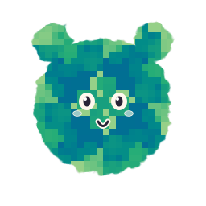 | 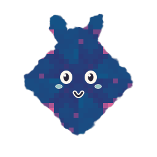 | 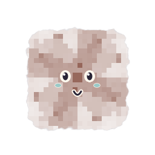 | 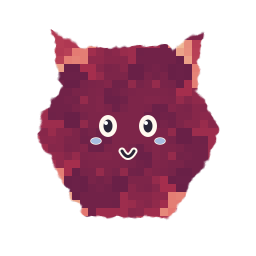 | 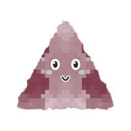 |
| `example:6` | `example:10` | `example:5` | `example:1` | `example:0` |

### Sprout

Sprout adds an egg silhouette to the original five shapes.

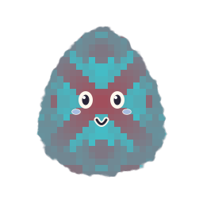

The first and only recipe is `kawaii-lifehash-v5`. It selects from pebble, droplet, capsule, bloom, comet, and egg, with a soft coat by default.

### Coat textures

The default `kawaii-lifehash-v5` recipe uses a soft coat, between smooth and fluffy. Smooth, fluffy, and shaggy remain available as presentation overrides. It uses the six-shape family and the same LifeHash fingerprint. Smooth coats have a subtle soft edge rather than a perfectly clean outline. Texture becomes subtler at small sizes.

| Smooth | Soft (default) | Fluffy | Shaggy |
| --- | --- | --- | --- |
| 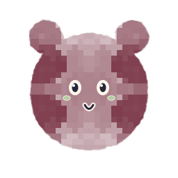 | 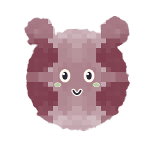 | 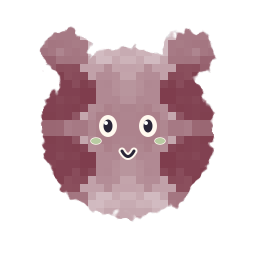 | 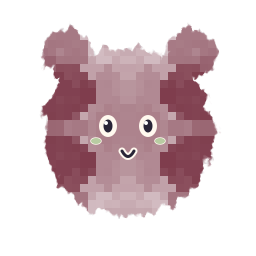 |

These examples use `example:0`, the pebble silhouette, and a presentation override to compare coats on the same identity.

```ts
const identity = await generateAvatar('example:0', {
  recipe: 'kawaii-lifehash-v5',
});
const svg = avatarSVG(identity, { coat: 'fluffy' });
```

```html
<lifehash-avatar seed="example:0" recipe="kawaii-lifehash-v5"
  state="idle" size="256"></lifehash-avatar>
```

### Expressions

The same avatar (`seed="example:6"`) in each presentation state. Expressions change while its identity and LifeHash coat stay the same.

| Idle | Thinking | Speaking |
| --- | --- | --- |
|  | 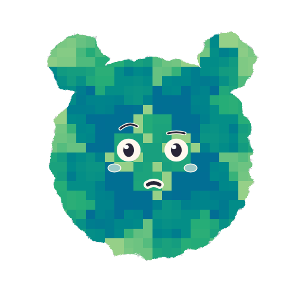 |  |

| Listening | Success | Error |
| --- | --- | --- |
| 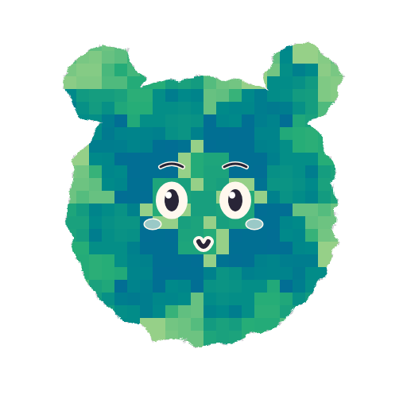 | 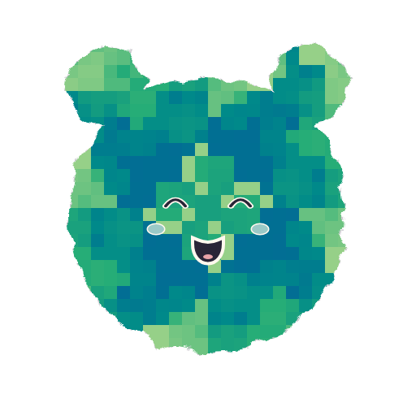 | 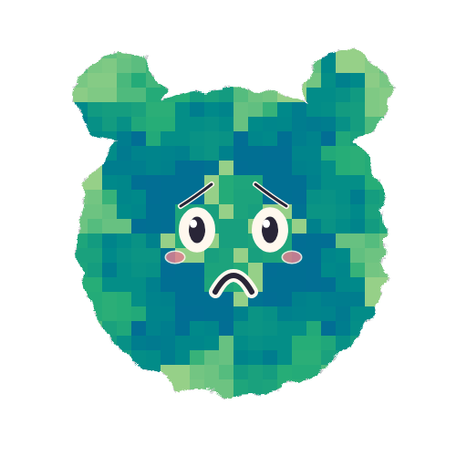 |

| Sleepy | Curious | Confused |
| --- | --- | --- |
|  | 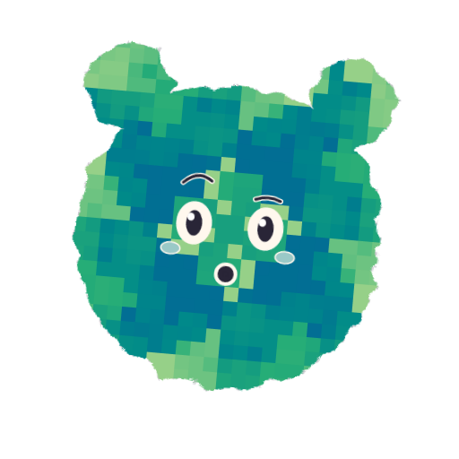 | 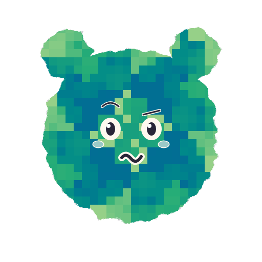 |

Set the expression with the component's `state` attribute:

```html
<lifehash-avatar seed="example:6" state="success" size="256"></lifehash-avatar>
```

## Run the local demo

```sh
npm ci
npm run dev
```

Open the local URL printed by Vite. Type a seed, change the mood, and download the neutral SVG. Build the separate static demo with `npm run build:demo`; its relative assets support hosting beneath a nested path.

## Open an avatar by URL

Pass a string as the `seed` query parameter to prefill the input and render its avatar:

[Render researcher:42](https://kawaii-lifehash.pages.dev/?seed=researcher%3A42)

```ts
const url = new URL('https://kawaii-lifehash.pages.dev/');
url.searchParams.set('seed', 'hello world 😀');
```

An omitted parameter uses the demo's default seed. `?seed=` uses the empty string. URL encoding preserves spaces, emoji, and punctuation; encode a literal plus as `%2B`. You can still edit the seed and change expressions after opening the link. Use **Copy avatar link** to update the URL with your current input and copy it to the clipboard.

## Install the local archive

```sh
npm run pack:local
npm install /absolute/path/to/artifacts/kawaii-lifehash-0.1.0.tgz
```

Generate and export in a secure-context browser with Canvas, Web Crypto and WebAssembly:

```ts
import { generateAvatar, avatarSVG } from 'kawaii-lifehash';
const identity = await generateAvatar('researcher:42');
const svg = avatarSVG(identity, { size: 256, label: 'Research companion' });
```

The root imports safely during SSR and does not register an element. Generation is browser-only. The bundled WASM initializes automatically, without fetches or manual asset copying. `identity.fingerprint.dataURI` displays the complete 32×32 square; use `image-rendering: pixelated` when enlarging it. Its pixels match the licensed LifeHash reference engine.

## Web Component SDK example

The [live demo](https://kawaii-lifehash.pages.dev/#sdk-title) includes highlighted HTML and JavaScript examples. Its markup updates as you change the seed or expression.

After installing the local package, import the component and styles once in your browser app:

```js
import 'kawaii-lifehash/component';
import 'kawaii-lifehash/styles.css';
```

Then add the component to your HTML:

```html
<lifehash-avatar seed="researcher:42" state="curious" size="128"
  aria-label="Research companion"></lifehash-avatar>
```

The avatar generates and displays itself automatically. Change `seed` to generate another identity, or `state` to change its expression. The default uses the six-shape family and soft coat.

State values: `idle`, `thinking`, `speaking`, `listening`, `success`, `error`, `sleepy`, `curious`, `confused`. Speaking is silent. Reduced motion disables decorative animation and pointer response. Set `aria-hidden="true"` for decorative instances. A meaningful instance uses `aria-label` or its default character name.

`identity` is the last successfully resolved immutable identity. `status` is `pending`, `resolved`, or `failed`. `ready` represents the current generation; a new seed or disconnection rejects the earlier promise. `identity-resolved` carries the identity; `generation-error` carries `{kind, error}`, where kind distinguishes input from initialization. Invalid attributes or properties emit an input error and retain the last valid values. There is no unhandled rejection from declarative markup alone.

## Input and rendering rules

See [What strings can I use?](#what-strings-can-i-use) for seed examples and exact input behavior. Invalid seed arguments passed to `generateAvatar()` reject with a `TypeError`; invalid component inputs emit `generation-error` and retain the last valid value.

SVG options accept only `size` (positive finite pixels), `label` (scalar string), `coat` (`smooth`, `soft`, `fluffy`, `shaggy`), and `shape` (`pebble`, `droplet`, `capsule`, `bloom`, `comet`, `egg`). Invalid options throw TypeError or RangeError. XML-forbidden control characters in labels serialize as U+FFFD; seed hashing is unaffected. Native `aria-label` retains browser semantics; ill-formed UTF-16 is replaced only in the rendered text alternative.

Identity traits derive from the SHA-256 digest; moods and pointer position do not affect identity or neutral export. Static SVG is byte-stable for identical identity/options and browser engine/version. Fingerprint data URIs are canonical SVG images built from the RGBA pixels, and the renderer rejects mismatched image/pixel data. Externally supplied identity records are syntax-checked; the package does not claim that an untrusted caller's pixels prove a digest. Use `generateAvatar` for authentic identities. Cropped artwork is not an authentication fingerprint.

## Verify and review

```sh
npx playwright install chromium firefox webkit
npm test
npm run typecheck
node scripts/mutation.mjs
node scripts/consumer.mjs
```

`npm test` builds an independent C++ reference oracle using a C++17 compiler, then runs Chromium, Firefox and WebKit acceptance tests.

Inspired by the idea of expressive agent avatars in Kawaii-Dots by Jérôme Massot. The implementation is authored locally; its shapes and expressions were informed by the owner's authorized hosted visual reference. Attribution-only reference: https://github.com/jeromemassot/Kawaii-Dots. LifeHash is by Wolf McNally, Christopher Allen and Blockchain Commons. Full dependency licenses and pinned sources accompany [NOTICE.md](NOTICE.md).

## License

Repository-authored code and assets are licensed under [Apache License 2.0](LICENSE). Third-party dependencies retain their own licenses; see [NOTICE.md](NOTICE.md) and the included dependency license files.
